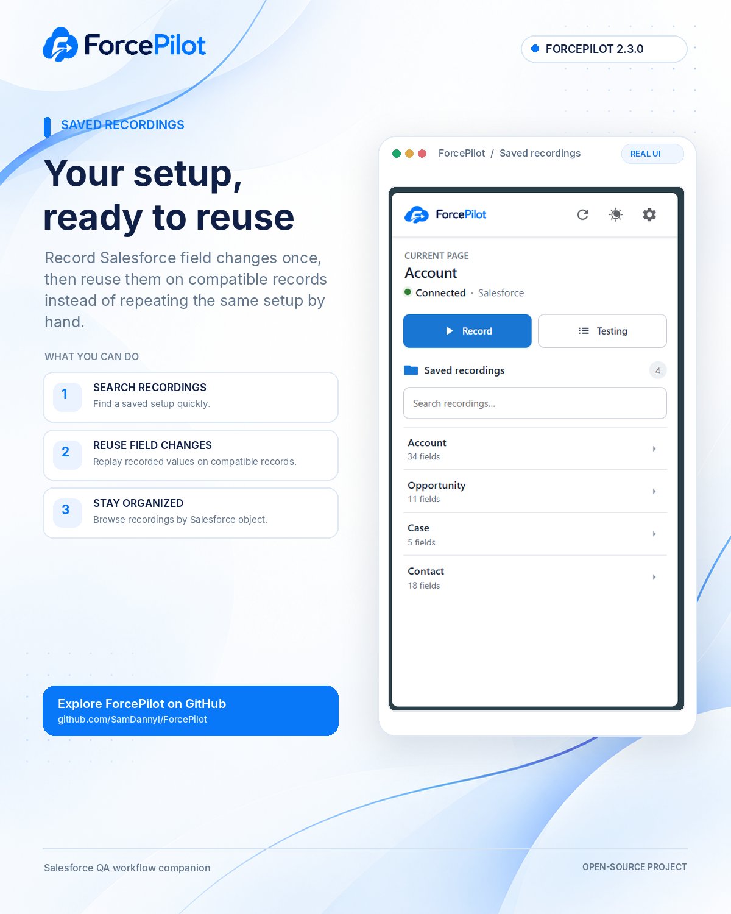
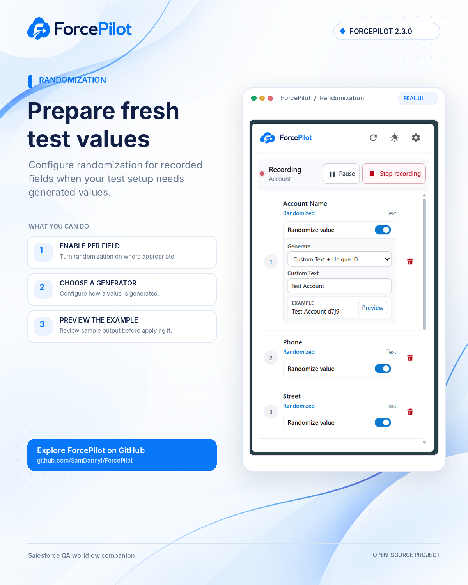
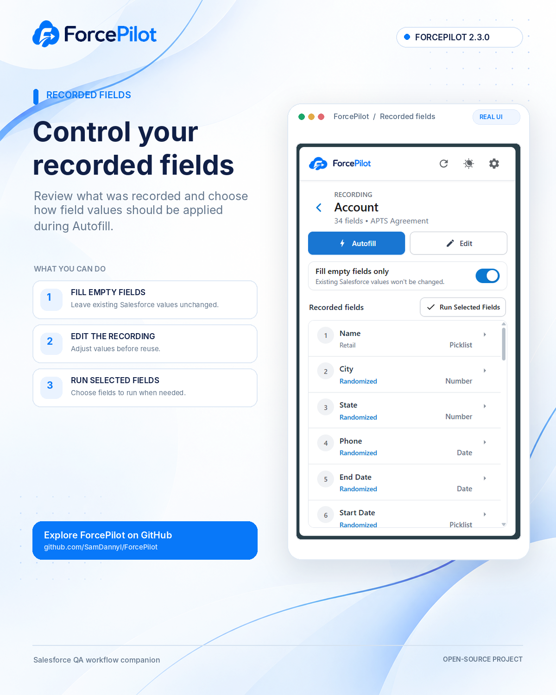
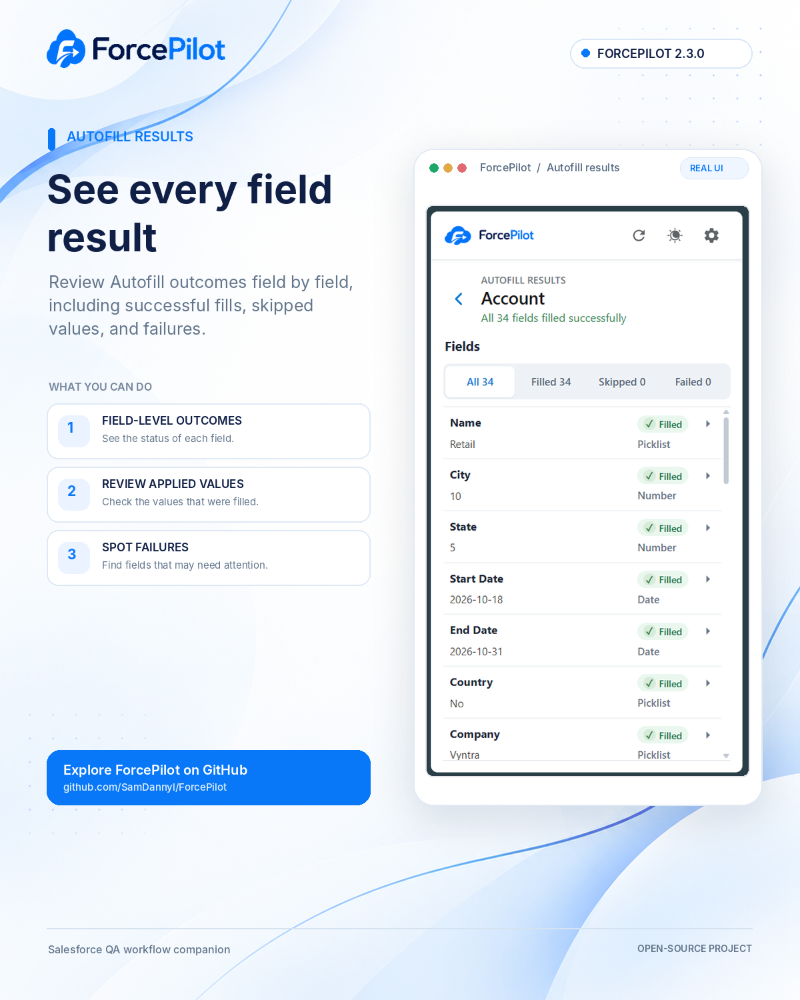
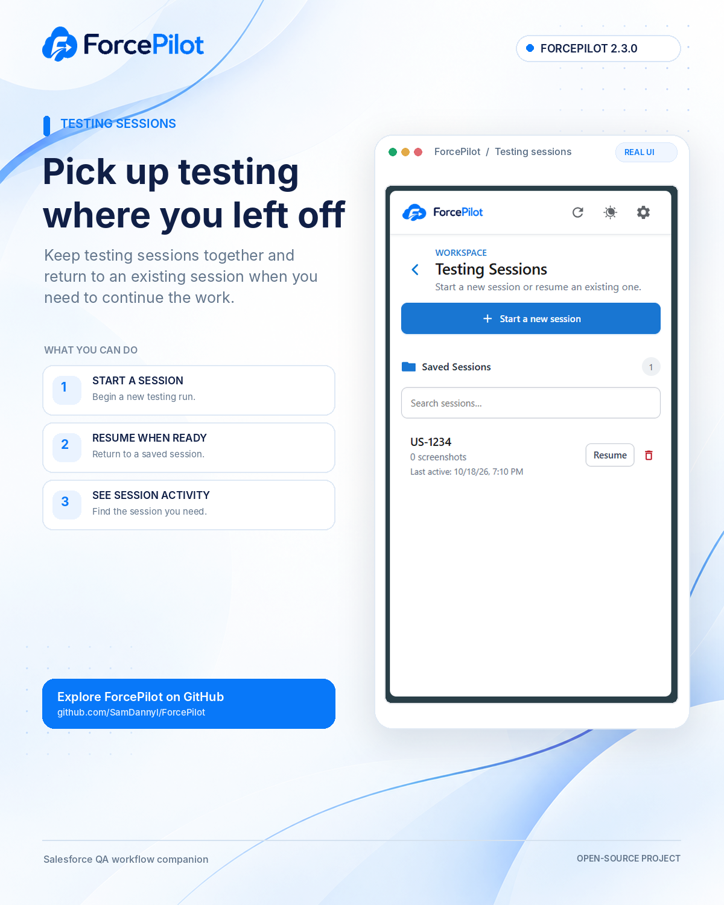
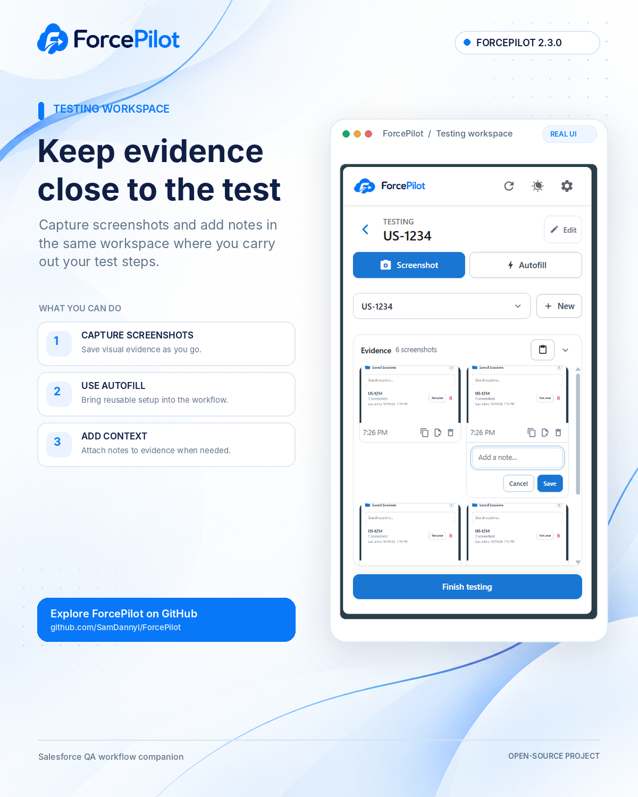
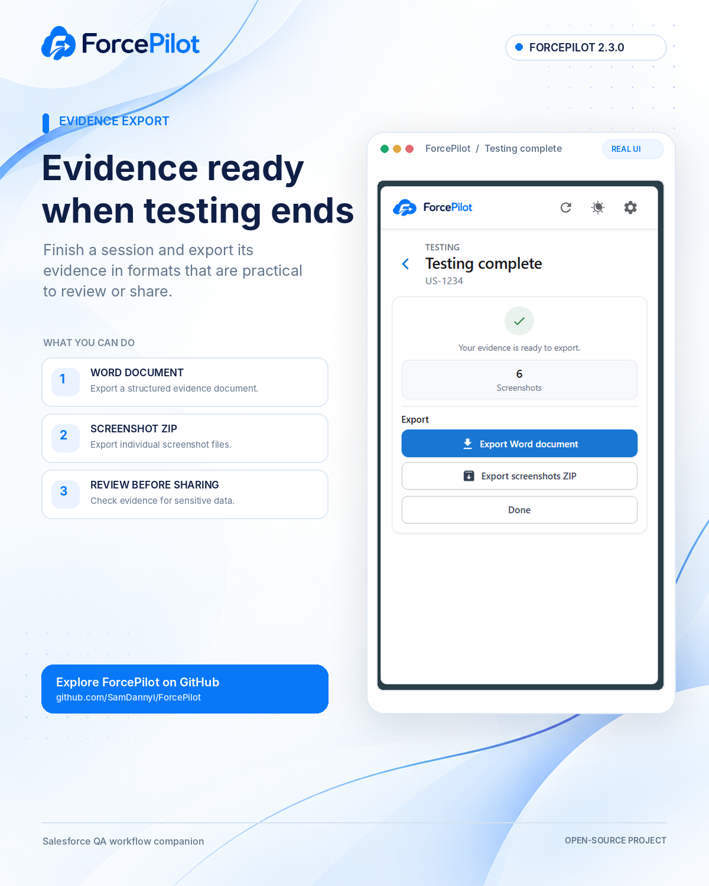

<p align="center">
  
</p>

<h1 align="center">ForcePilot — Salesforce Autofill &amp; Testing</h1>

<p align="center">
  <strong>Test faster. Document better.</strong><br>
  Simplify Salesforce testing, automate repetitive record creation, capture test evidence, and export test documentation.
</p>

<p align="center">
  <a href="https://samdannyl.github.io/ForcePilot/marketing/">Explore the interactive product tour</a>
  ·
  <a href="https://github.com/SamDannyl/ForcePilot/issues">Report an issue</a>
</p>

---

ForcePilot is a Chrome extension built to make repetitive Salesforce QA work easier. Save field values for reuse, generate test data, organize testing sessions, capture screenshots as evidence, and export the results for documentation.

## Features

### Record and autofill Salesforce fields

- Save reusable recordings of Salesforce field values.
- Reuse recorded values on similar records and forms.
- Select the fields to run, or autofill the full recording.
- Choose to fill empty fields only, helping preserve existing values.
- Review field-level autofill results and retry failures.

### Generate test data

- Generate values for supported field types, including text, names, email, phone, URLs, numbers, currency, percentages, dates, date/time, picklists, multi-select picklists, checkboxes, and address fields.
- Use **Custom Text + Unique ID** when test values need a recognizable prefix and a unique suffix.
- Generate dates relative to the current date or within a date range.
- Choose a random valid picklist option or select from specific values.
- Use field-level randomization settings when preparing varied test records.

### Capture and export testing evidence

- Create and resume testing sessions.
- Start with imported scenario titles or begin a session without scenarios.
- Import scenario titles from Excel/TSV, Markdown tables, or plain-text lists. The importer uses scenario titles; other columns are ignored.
- Track scenario outcomes with **Pass**, **Fail**, or **Blocked** statuses.
- Capture screenshots, associate captures with scenarios, and review unassigned screenshots.
- Export a Word document and a ZIP archive of screenshots.

### Designed for everyday QA work

- Use ForcePilot from its Chrome side panel.
- Switch between light and dark themes.
- Use the keyboard shortcut **Alt+S** to capture a screenshot in the active testing session.
- Use **Alt+X** to open ForcePilot on the current Salesforce tab.

## Product tour

The interactive tour is hosted with GitHub Pages:

**[Open the ForcePilot product tour](https://samdannyl.github.io/ForcePilot/marketing/)**

The tour follows the workflow from saved recordings and randomization through autofill results, testing sessions, the testing workspace, and evidence export.

### Screenshots

<table>
  <tr>
    <td align="center"><a href="docs/marketing/assets/01-saved-recordings.png"></a><br><sub>Saved recordings</sub></td>
    <td align="center"><a href="docs/marketing/assets/02-randomization.png"></a><br><sub>Randomization</sub></td>
    <td align="center"><a href="docs/marketing/assets/03-recorded-fields.png"></a><br><sub>Recorded fields</sub></td>
  </tr>
  <tr>
    <td align="center"><a href="docs/marketing/assets/04-autofill-results.png"></a><br><sub>Autofill results</sub></td>
    <td align="center"><a href="docs/marketing/assets/05-testing-sessions.png"></a><br><sub>Testing sessions</sub></td>
    <td align="center"><a href="docs/marketing/assets/06-testing-workspace.png"></a><br><sub>Testing workspace</sub></td>
  </tr>
</table>

<p align="center"><a href="docs/marketing/assets/07-evidence-export.png"></a><br><sub>Evidence export</sub></p>

## Install the extension locally

ForcePilot is packaged as a Chrome Manifest V3 extension. To load this repository as an unpacked extension:

1. Download the repository ZIP and extract it, or clone the repository.
2. Open `chrome://extensions` in Chrome.
3. Turn on **Developer mode**.
4. Select **Load unpacked**.
5. Choose the repository folder containing `manifest.json`.
6. Open a Salesforce page and launch ForcePilot from the Chrome toolbar or side panel.

After pulling updates, return to `chrome://extensions` and use the extension's **Reload** control to load the changed files.

## Using ForcePilot

### Reuse a field recording

1. Open the Salesforce page and start a recording.
2. Make the required field changes in Salesforce and save the recording.
3. Open a compatible record or form, choose the saved recording, and review the fields.
4. Optionally enable **Fill empty fields only**, then run autofill.
5. Review the results and retry fields that did not fill successfully.

### Run a testing session

1. Open **Testing** and start a new session.
2. Import scenario titles, or start without scenarios.
3. Capture screenshots as you work in Salesforce.
4. Assign screenshots to scenarios and mark each outcome as Pass, Fail, or Blocked.
5. Finish testing, then export the Word document and/or screenshots ZIP.

## Repository layout

```text
.
├── manifest.json              # Chrome extension manifest
├── background.js              # Background service worker
├── popup.html / popup.js       # Toolbar popup
├── sidepanel.html / sidepanel.js
├── sidepanel.css               # Main side-panel UI styles
├── options.html / options.js   # Extension settings
├── page_bridge.js              # Salesforce page bridge
├── src/                        # Autofill, randomization, testing, exports and shared code
├── branding/                   # ForcePilot brand assets
├── icons/                      # Extension icons
├── docs/
│   ├── marketing/
│   │   ├── index.html          # Standalone interactive product tour
│   │   └── assets/             # Tour screenshots and brand assets
│   └── PUBLISHING_WEBSITE.md   # GitHub Pages instructions
├── README.md
└── CHANGELOG.md
```

## Publish the product tour with GitHub Pages

The website is a static page and does not require a build step. In the GitHub repository, open **Settings → Pages**, choose **Deploy from a branch**, select the default branch and the `/docs` folder, then save. After GitHub Pages publishes the site, the tour should be available at:

`https://samdannyl.github.io/ForcePilot/marketing/`

See [`docs/PUBLISHING_WEBSITE.md`](docs/PUBLISHING_WEBSITE.md) for the steps and troubleshooting notes.

## Compatibility and safe use

- Designed for Chrome and Salesforce pages covered by the host patterns in `manifest.json`.
- Autofill can change values on the active Salesforce page. Review the selected recording and generated values before applying them, and use a test/sandbox environment for QA wherever possible.
- Scenario imports currently extract scenario titles; they do not import every column of a test-management spreadsheet.

## Release notes

See [`CHANGELOG.md`](CHANGELOG.md) for the changes included in **2.3.0**.

---

ForcePilot is an independent project and is not affiliated with or endorsed by Salesforce, Inc.
